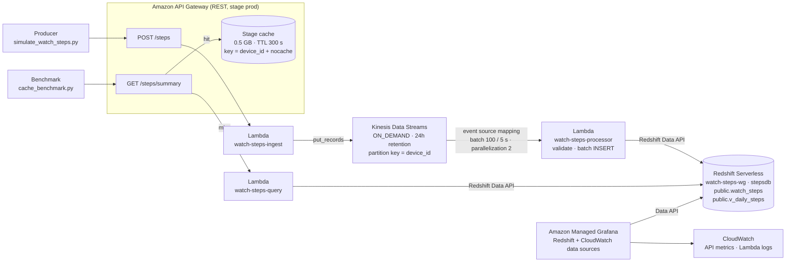

# watch-steps-pipeline

A real-time pipeline on AWS for **Apple Watch step counts**, defined entirely with Terraform:
**API Gateway → Kinesis → Lambda → Redshift Serverless → Amazon Managed Grafana**, with an
**API Gateway response cache** in front of the read path so the API keeps its latency under many
concurrent requests.

> ## ⚠️ COST WARNING
> The **API Gateway cache cluster bills for every hour it exists**, and so do the Kinesis
> on-demand stream and the Managed Grafana workspace. Redshift Serverless bills per RPU-second
> while queries run. **Run `terraform destroy` at the end of every lab session.**

## Architecture



Event schema (only the `steps` metric is handled):

```json
{"device_id": "apple-watch-01", "device_type": "apple_watch", "metric": "steps",
 "value": 12, "unit": "count", "timestamp": 1760371200000}
```

`value` is the number of steps **since the device's previous event** (an increment, not a
running total), so `SUM(steps)` gives correct totals for any time window.

## How the requirements map to the code

| Requirement | Implementation | File |
|---|---|---|
| AWS API Gateway | REST API with `POST /steps` (ingest) and `GET /steps/summary` (read), stage `prod` | `terraform/apigateway.tf` |
| AWS Kinesis / SQS | Kinesis Data Streams, **ON_DEMAND** mode | `terraform/kinesis.tf` |
| AWS Kafka / Lambda | 3 Lambdas: ingest, processor (Kinesis trigger), query | `terraform/lambda.tf`, `lambdas/` |
| AWS Redshift Serverless | Namespace + workgroup (8 RPU base); table, view and grants via the Data API | `terraform/redshift.tf` |
| AWS Managed Grafana | Workspace + service account; data sources and 2 dashboards via the `grafana` provider | `terraform/grafana.tf`, `grafana/dashboards/` |
| Terraform | Everything above; `terraform apply` / `destroy` | `terraform/` |
| Many requests without degrading | API Gateway cache, throttling (1000 rps / burst 500), Kinesis on-demand, ESM parallelization, Redshift Serverless auto-scaling | see below |
| Cache not loaded vs loaded metrics | `loadtest/cache_benchmark.py` | `loadtest/` |

## Handling many requests without degrading

* **Response cache (the main lever).** `GET /steps/summary` runs a Redshift query through the
  Data API (execute → poll → fetch), which takes roughly a second, and Redshift only runs a limited
  number of queries at once. The stage has a **0.5 GB cache cluster** with a **300 s TTL**, keyed by
  `?device_id=`. After the first request for a key, API Gateway answers from memory and neither
  Lambda nor Redshift is called. Latency stays flat no matter how many clients ask for the same data.
* **Throttling.** Every method is limited to 1000 rps with a burst of 500. An overload gets `429`
  responses instead of slowing down every request.
* **Ingestion scales on its own.** Kinesis **ON_DEMAND** adds shards as the write rate grows. The
  event source mapping processes **2 batches per shard in parallel** (still in order per
  `device_id`), and each batch is one multi-row `INSERT`.
* **Redshift Serverless** adds RPUs under load and costs nothing while idle.

## Project layout

```
watch-steps-pipeline/
├── terraform/
│   ├── versions.tf        # Terraform >= 1.5, aws ~> 5.60, archive ~> 2.4, grafana ~> 3.0
│   ├── providers.tf       # aws (profile/region) + grafana (workspace URL + token)
│   ├── variables.tf
│   ├── network.tf         # default VPC + subnets
│   ├── apigateway.tf      # REST API, methods, Lambda permissions, stage + cache, method settings
│   ├── kinesis.tf
│   ├── lambda.tf          # LabRole lookup, 3 functions, log groups, Kinesis trigger
│   ├── redshift.tf        # Serverless namespace + workgroup, table/view/grants via Data API
│   ├── grafana.tf         # Managed Grafana (default) or Grafana OSS on EC2 (fallback)
│   ├── outputs.tf
│   ├── templates/grafana_user_data.sh.tftpl
│   └── terraform.tfvars.example
├── lambdas/
│   ├── ingest/handler.py     # POST /steps -> Kinesis
│   ├── processor/handler.py  # Kinesis -> Redshift
│   └── query/handler.py      # GET /steps/summary -> Redshift
├── grafana/
│   ├── dashboards/watch-steps.json          # steps from Redshift
│   ├── dashboards/api-gateway.json.tftpl    # cache hits/misses + latency from CloudWatch
│   └── provisioning/                        # used only by the EC2 fallback
├── producer/simulate_watch_steps.py
├── loadtest/cache_benchmark.py  # cache not loaded vs loaded
├── loadtest/smoke_test.py       # end-to-end API check
├── .gitignore
└── README.md
```

## AWS Academy constraints

* **No IAM creation.** The project contains no `aws_iam_*` resources. All Lambdas and the Managed
  Grafana workspace (`permission_type = "CUSTOMER_MANAGED"`) use the existing **`LabRole`**. API
  Gateway invokes Lambda through resource-based `aws_lambda_permission`s, which need no role.
* **Credentials** come only from the `academy` CLI profile. The Redshift admin password is a
  `sensitive` variable in the uncommitted `terraform.tfvars`.
* **Services Academy denies (verified with `terraform apply`).** The Terraform code supports
  them, and they're the defaults, but the Learner Lab role gets `AccessDenied` for:
  * `redshift-serverless:CreateNamespace`. Use **`redshift_mode = "provisioned"`**, a single-node
    `ra3.large` cluster. Lambdas and Grafana use the same Data API either way.
  * `grafana:CreateWorkspace` (and `grafana:TagResource`). Use **`grafana_mode = "ec2"`** (plus
    `allowed_cidr`). The same data sources and dashboards then run on Grafana OSS on a `t3.micro`.
  * `kinesis:IncreaseStreamRetentionPeriod`, so the stream keeps the default 24 h retention.

  In a regular account, keep `redshift_mode = "serverless"` and `grafana_mode = "managed"`
  (Managed Grafana also needs IAM Identity Center; set `grafana_admin_user_ids`).
* **Data API identity (Serverless).** Requests through `WorkgroupName` without a secret are mapped to a
  database user named after the IAM identity (`IAMR:LabRole` for Lambda, `IAMR:voclabs` for
  Terraform). The table and view are therefore `GRANT`ed to `PUBLIC`.
* **Credential expiry.** Learner Lab credentials expire about every 4 hours (`ExpiredToken`).
  Refresh `~/.aws/credentials` and re-run. Resources keep running (and billing) meanwhile.

## Running it

### 0. Prerequisites

* Terraform ≥ 1.5, AWS CLI, Python 3.9+.
* Learner Lab → **Start Lab** → **AWS Details → AWS CLI: Show**. Paste the values into
  `~/.aws/credentials` under `[academy]`, then check with `aws sts get-caller-identity --profile academy`.

### 1. Configure

```bash
cd watch-steps-pipeline/terraform
cp terraform.tfvars.example terraform.tfvars
# edit: redshift_admin_password, grafana_mode (and allowed_cidr if grafana_mode = "ec2")
```

### 2. Deploy

```bash
terraform init
terraform plan -out tfplan
terraform apply tfplan
terraform output
# api_base_url, summary_url, kinesis_stream_name, redshift_workgroup, lambda_function_names, grafana_url
```

The Redshift Serverless workgroup and the API Gateway cache cluster each take a few minutes to
become available.

### 3. Send data through API Gateway

```bash
cd ../producer
python3 simulate_watch_steps.py --api-url "$(terraform -chdir=../terraform output -raw api_base_url)" \
    --duration 600 --interval 5 --devices 3
```

With `--api-url` the producer uses only the standard library, so no virtualenv is needed. `boto3`
(`pip install -r requirements.txt`) is needed only to write to Kinesis directly (without `--api-url`).

Automated end-to-end check (POST, invalid POST, the row arriving in Redshift, cache hit):

```bash
python3 ../loadtest/smoke_test.py --api-url "$(terraform -chdir=../terraform output -raw api_base_url)"
# [PASS] ... 4/4 checks passed
```

You can also call the API by hand:

```bash
API=$(terraform -chdir=../terraform output -raw api_base_url)
curl -X POST "$API/steps" -d '{"device_id":"apple-watch-01","metric":"steps","value":20,"timestamp":'$(date +%s000)'}'
curl "$API/steps/summary?device_id=apple-watch-01"
```

The Kinesis trigger starts at `LATEST`, so send data after `apply` finishes. Logs:
`aws logs tail /aws/lambda/watch-steps-processor --follow --profile academy`.

### 4. Benchmark: cache not loaded vs loaded

```bash
cd ../loadtest
python3 cache_benchmark.py --url "$(terraform -chdir=../terraform output -raw summary_url)" \
    --requests 200 --concurrency 20 --json-out results.json
```

1. **SIN CACHE.** Every request adds a unique `?nocache=<uuid>`. That parameter is part of the
   cache key, so each request asks for an entry that was never loaded and goes through
   Lambda → Redshift.
2. **Warm-up.** One request per `device_id` loads the cache.
3. **CON CACHE.** The same requests, now answered from the stage cache.

The script prints a table (avg / p50 / p90 / p95 / p99 / max latency, throughput, errors) and the
speed-up factor. Take a screenshot of it for the report. The **Apple Watch - API Gateway & cache**
dashboard in Grafana shows the same run as `CacheHitCount` vs `CacheMissCount` and `Latency` vs
`IntegrationLatency`.

### 5. Grafana

* Open `grafana_url`. Managed Grafana: sign in with IAM Identity Center. EC2 fallback: `admin` /
  `admin`, then change the password.
* Folder **Apple Watch**:
  * **Apple Watch - Steps**: steps over time, totals today, daily totals for the last 7 days (Redshift).
  * **Apple Watch - API Gateway & cache**: cache hits/misses, latency, requests and errors (CloudWatch).

### 6. Query Redshift directly

Use **Query Editor v2** (workgroup `watch-steps-wg`, database `stepsdb`) or the CLI:
`aws redshift-data execute-statement --workgroup-name watch-steps-wg --database stepsdb --sql "..." --profile academy`.

```sql
-- Daily totals per device
SELECT device_id, day, total_steps FROM public.v_daily_steps ORDER BY day DESC, device_id;

-- Average steps per hour per device
SELECT device_id, AVG(hourly_steps) AS avg_steps_per_hour
FROM (SELECT device_id, DATE_TRUNC('hour', event_ts) AS hour, SUM(steps) AS hourly_steps
      FROM public.watch_steps GROUP BY 1, 2) h
GROUP BY device_id ORDER BY avg_steps_per_hour DESC;

-- End-to-end latency (event time -> row written)
SELECT device_id, AVG(DATEDIFF(ms, event_ts, ingested_at)) AS avg_latency_ms
FROM public.watch_steps WHERE ingested_at >= DATEADD(minute, -15, GETDATE()) GROUP BY device_id;
```

All timestamps are stored in **UTC**.

### 7. Tear down (every session!)

```bash
cd watch-steps-pipeline/terraform
terraform destroy
```

## Lambda details

* **Ingest** (`POST /steps`) accepts one event, an array, or `{"records": [...]}` (max 500).
  It checks only that each event has a `device_id`, the Kinesis partition key, and writes the
  batch with one `put_records`. It returns `{"accepted": n, "failed": m}`.
* **Processor** (Kinesis trigger: batch 100, 5 s window, parallelization 2, bisect on error,
  2 retries, `ReportBatchItemFailures`). It fully validates each record (metric, `device_id`,
  non-negative integer `value`, timestamp) and writes the batch with **one parameterized multi-row
  `INSERT`** through `ExecuteStatement(WorkgroupName=...)`. Lambda restarts from the **lowest**
  failed sequence number, so the handler inserts only the valid records before the first invalid
  one and reports that one. Insert failures raise, and the atomic `INSERT` is retried as a whole.
* **Query** (`GET /steps/summary[?device_id=]`) returns per-device `steps_today`,
  `steps_last_hour`, `events_today` and `last_event_ts`. The `X-Backend-Ms` header holds how long
  the Redshift round trip took. It is cached along with the body.

## Lab-only security trade-offs

* The API has no authorization, and the `nocache` key parameter lets any client force a backend
  call. In production you'd add an API key/usage plan or a Cognito/IAM authorizer and drop
  `nocache` from the cache key.
* Objects are granted to `PUBLIC` and every component uses the broad `LabRole`. Production would
  use least-privilege database users and per-function roles.
* Redshift Serverless is encrypted and **not publicly accessible**. All access goes through the
  IAM-authenticated Data API. Cached API responses are encrypted (`cache_data_encrypted`).
* EC2 fallback only: Grafana listens on plain HTTP :3000, open only to `allowed_cidr`. IMDSv2 is
  required and the root volume is encrypted.
